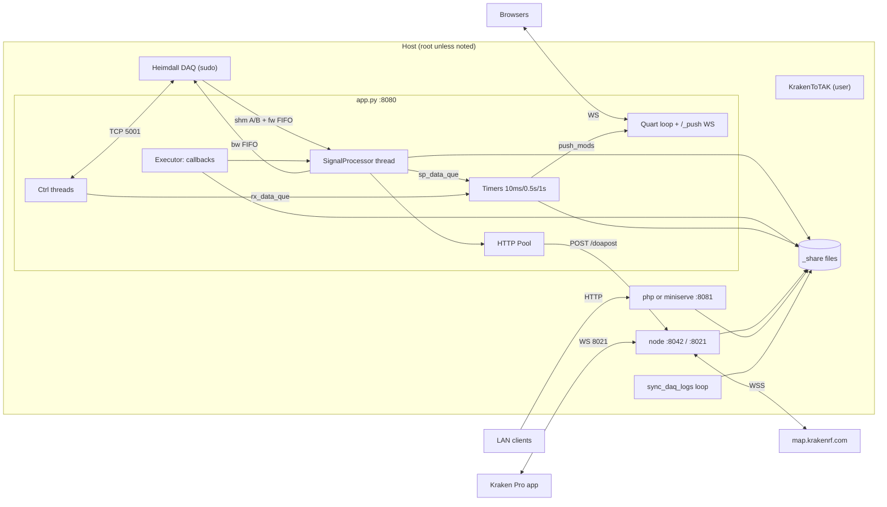
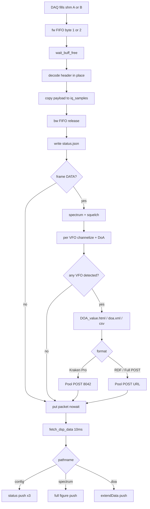
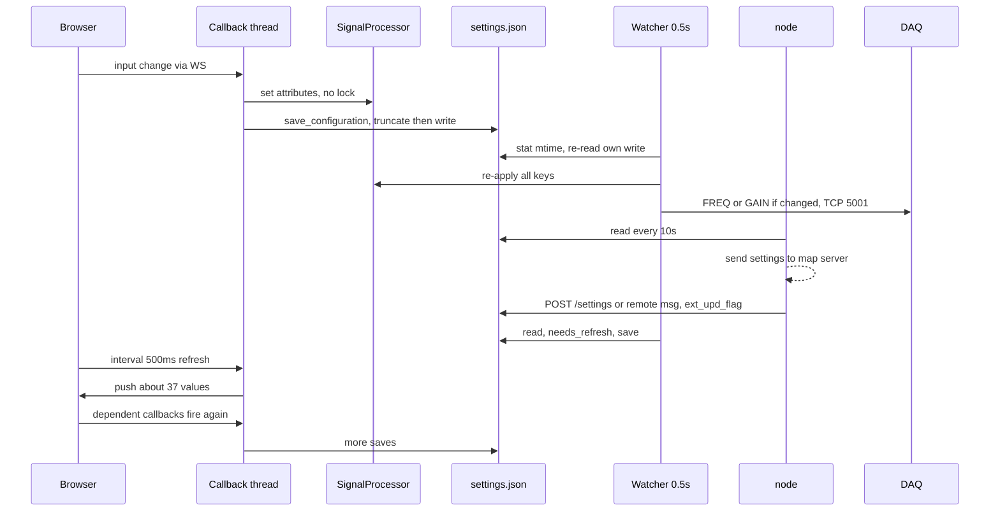
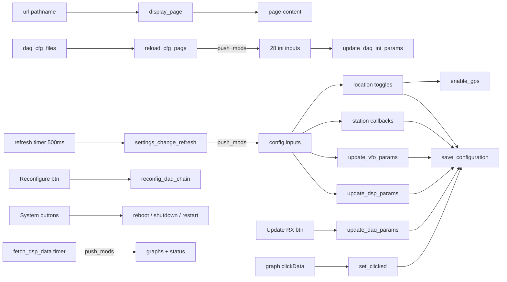

# KrakenSDR DoA: system map

This file describes how this fork works, as the code executes it.

- Branch `optimization`, commit `2e1c4e6`, audited 2026-11-24.
- Rule used for the audit: **the executable code is the only source of truth.** Comments, the README, tooltips and names were treated as unverified claims.
- Every statement cites `file:line` or an experiment that was run.
- The improvement work that follows from this map is in [TASKS.md](TASKS.md).

## File abbreviations

| Short | File |
|---|---|
| `sp` | `_sdr/_signal_processing/kraken_sdr_signal_processor.py` |
| `su` | `_sdr/_signal_processing/signal_utils.py` |
| `rx` | `_sdr/_receiver/kraken_sdr_receiver.py` |
| `shm` | `_sdr/_receiver/shmemIface.py` |
| `hdr` | `_sdr/_receiver/iq_header.py` |
| `kwi` | `_ui/_web_interface/kraken_web_interface.py` |
| `utils` | `_ui/_web_interface/utils.py` |
| `vars` | `_ui/_web_interface/variables.py` |
| `cb` | `_ui/_web_interface/callbacks/main.py` |
| `node` | `_nodejs/index.js` |

## 1. What is in this repo, and what is not

| Layer | In this repo | Notes |
|---|---|---|
| KrakenSDR hardware (5 coherent RTL-SDR channels) | no | Not connected during the audit. |
| Heimdall DAQ firmware (acquisition, calibration, sync) | **no** | Expected at sibling path `../heimdall_daq_fw` (`vars:41,55`, `rx:78-80`). Its source is not on this machine. Only its interface, as this repo consumes it, is mapped here. |
| Receiver: shared memory, FIFOs, control socket | yes | `_sdr/_receiver/` |
| DSP: spectrum, squelch, channelizer, DoA | yes | `_sdr/_signal_processing/` |
| Web UI (Dash 1.x fork `dash_devices` on Quart) | yes | `_ui/_web_interface/` |
| Node.js middleware for the Kraken Pro app and the map server | yes | `_nodejs/` |
| Start, stop and kill scripts | yes | `gui_run.sh`, `kill.sh`, `util/` |
| Tests | **none** | The repo has zero tests. |

Other private copies of the signal processor exist. They differ from this fork by 30 to 112 changed lines. Which copy is deployed is an open question for the owner (see TASKS.md, open decisions).

## 2. Runtime topology

Everything below `gui_run.sh` runs as root (`util/kraken_doa_start.sh:20,23`).

### 2.1 Start and stop order

1. `util/kraken_doa_start.sh` activates the conda env `kraken`, then runs `kraken_doa_stop.sh` (`:4-15`).
2. It starts Heimdall with `sudo ./daq_start_sm.sh`, then sleeps 1 s (`:18-21`).
3. It starts `gui_run.sh` with sudo (`:23`). That script starts four processes:
   - `util/sync_daq_logs.sh`, a copy loop every 5 s (`gui_run.sh:43`).
   - `python3 _ui/_web_interface/app.py` on `0.0.0.0:8080` (`gui_run.sh:46`, `app.py:36`).
   - A static file server on `0.0.0.0:8081` over `_share`: `php -S`, or `miniserve` with upload enabled when `en_remote_control` is true (`gui_run.sh:14-19,51`).
   - `node _nodejs/index.js` (`gui_run.sh:55`).
4. `kill.sh` stops `app.py`, every `php` process and every `node` process on the host (`kill.sh:2-18`). It never stops `miniserve` or the log sync loop.

### 2.2 Threads inside app.py

| Thread | Created at | Rate | Notes |
|---|---|---|---|
| Quart event loop | `app.py:36` | event driven | HTTP and the websocket `/_push`. |
| Callback executor | `dash_devices` | per UI event | Runs every Dash callback. |
| SignalProcessor | `kwi:173`, again at `cb:1150-1175` | one loop per IQ frame | `while True` at `sp:352`. Old instances never exit after a DAQ reconfigure. |
| HTTP pool | `sp:215` | per output POST | `multiprocessing.dummy.Pool()`, one per SignalProcessor. |
| `fetch_dsp_data` timer | `utils:228` | **new thread every 10 ms** | Started by the first browser (`cb:49-50`). |
| `fetch_gps_data` timer | `utils:241` | 1 s | |
| `settings_change_watcher` timer | `utils:414` | 0.5 s | |
| DAQ control threads | `rx:296,351,383,402` | one per command | Serialized by a lock with no `try/finally`. |

### 2.3 Queues and locks

| Object | Size | Producer | Consumer | Behavior when full |
|---|---|---|---|---|
| `sp_data_que` (`kwi:53`) | 1 | DSP thread, one packet per frame (`sp:922-928`) | `utils:122` | Packet is dropped. |
| `rx_data_que` (`kwi:55`) | 1 | Control replies (`rx:144,170,330`) | `utils:101`, only while a browser is connected | **Producer blocks forever.** |
| Per-browser `asyncio.Queue` | unbounded | `push_mods` | websocket writer | Grows without limit. |

No lock protects the SignalProcessor fields, `settings.json`, or the plot figures. UI threads change them while the DSP thread reads them.

## 3. The path of one IQ frame

### 3.1 Signal chain, stage by stage

Symbols: `M` = active antenna channels, `N` = samples per frame (`cpi_length`), `fs` = sample rate from the header in Hz, `fc` = center frequency set by the UI in Hz, `Δf` = VFO frequency minus `fc`, `q` = decimation ratio.

| # | Stage | Where | Operation as coded | Output |
|---|---|---|---|---|
| 0 | Frame in | `rx:209-231` | Header unpacked into a shared object. Payload viewed as `complex64`, reshaped `(M, N)`, copied. No scaling, no DC removal. | `complex64 (M, N)` |
| 1 | Frame gate | `sp:375` | Only `frame_type == DATA` is processed. | |
| 2 | Global decimation | `sp:410-417` | `scipy.signal.decimate(x, q, n=5q, 'fir')`: Hamming FIR, cutoff `1/q`. `fs` becomes `fs // q`. | `complex64 (M, N/q)` |
| 3 | Spectrum | `sp:421-475` | Welch on **channel 1 only**, 4096 bins, then `10*log10` and `fftshift`. "All" mode uses a periodogram on the first 32768 samples only. | `float32` |
| 4 | Squelch threshold | `sp:261-293` | Auto: mean of the dB spectrum + 5 dB. Auto Channel: mean near the VFO + 3 dB. | dB value |
| 5 | VFO gate | `sp:509-588` | `q_v = max(fs // bw, 1)`. DoA runs only if the peak bin inside the VFO is above the threshold. | |
| 6 | Channelizer | `sp:1310-1331` | Hann FIR with `2q+1` taps, shifted to `Δf`, then `decimate` by `q`, then mixed down. | `complex128 (M, N/q)` |
| 7a | Virtual ULA transform | `sp:936-944,1528-1569` | Only for UCA with ROOT-MUSIC or decorrelation. Phase mode count `L = floor(k*r)`. | `(2L+1, N/q)` |
| 7b | Correlation matrix | `sp:947` | `R = X X^H / Nd`. Plain numpy. | `complex128 (M, M)` |
| 7c | Decorrelation | `sp:950-962` | FBA: `R = (R + J R* J) / 2`. TOEP: Toeplitz from diagonal means. FBSS: `pyargus`. FBTOEP was removed in M2-04; an unknown name runs as Off. | |
| 7d | Diagnostics | `estimate_DOA`, `mdl_source_count` | Correlated sources (M2-13): MDL(FB-smoothed raw R, subarray M - 1) - MDL(raw R), at least 0, for a ULA and the virtual array; always 0 for a plain UCA or a custom array, which have no shifted subarrays to smooth. A warning (at most once a minute) when the expected source count exceeds the MDL estimate. SNR (M2-14): the array (post-beamforming) SNR of the strongest signal, element SNR + 10log10(M) for one source, from the raw R: (lambda_max - sigma^2) / sigma^2 with sigma^2 the mean of the M - max(1, MDL) smallest eigenvalues, floored at -50 dB, and +100 dB when sigma^2 <= 0. | |
| 7e | Scanning vectors | `sp:1609-1668` | 360 vectors, one per degree. Cached, except for the custom array. | `complex64 (M, 360)` |
| 7f | Estimator | `sp:995-1020` | Bartlett, Capon, MEM (`pyargus`), TNA, MUSIC, ROOT-MUSIC (local, numba). | 360 values |
| 7g | ULA mask | `sp:1023-1033` | Forward or Backward mode sets half of the result to its minimum. | |
| 7h | Peak | `estimate_DOA` | `argmax` on the 1 degree grid. ROOT-MUSIC uses the last root. ULA: of theta and 180 - theta, Forward reports the one in [270, 360) or [0, 90), Backward the one in [90, 270), Both the smaller output angle (M2-01). | degrees |
| 8 | Post-processing | `sp:612-631,1703` | Log scale with a -100 dB floor. Confidence = `10*log10(max/mean)`. Power = peak dB bin. | |
| 9 | Outputs | `sp:752-900` | See section 6.3. | |

Not present anywhere in the chain: DC removal, time gating to the burst, tracking across frames, and reporting more than one peak.

### 3.2 Conventions as coded

| Topic | What the code does | Where |
|---|---|---|
| ULA element positions | Element `n` at `(0, -n*d)` | `sp:1631-1633` |
| UCA element positions | Element `n` at angle `-2*pi*n/M` (clockwise numbering) | `sp:1625-1630` |
| Angle | Counter-clockwise from the array x axis, toward the source | scanning vectors |
| ULA ambiguity | `θ` and `180 - θ` are the same to the array | physics |
| Spacing unit | Wavelengths at `fc`, rescaled per VFO by `f_v / fc` | `sp:974` |
| Array offset | Applied once after estimation on every path (M2-02): the spectrum is computed in the array frame, then `np.roll(P, -offset)`; ROOT-MUSIC reports (theta - offset) mod 360. Before M2-02 it was applied four different ways (finding P-03). | `estimate_DOA` |
| Compass offset | Only used in recording file names | |
| Bearing sent out | `360 - θ` in the CSV and Kerberos outputs, raw `θ` in XML, JSON and POST outputs | `sp:759,792,821,1118` |
| Frequency units | UI and `settings.json` in MHz, receiver and DSP in Hz, `doa.xml` in MHz, JSON in Hz | `kwi:64-66`, `sp:1100,1200` |
| Confidence | Peak-to-average ratio in dB of the 360-point spectrum, computed before the Forward/Backward mask (M2-15). ROOT-MUSIC uses the MUSIC spectrum of the same R and signal dimension (its drawn Gaussian gave a constant of about 21.5 dB). It is not an error estimate: see the paragraph below. | `estimate_DOA` |

The absolute direction (which way is 0 degrees, clockwise or not) cannot be confirmed without the hardware. All offline tests are self-consistent with the code's own sign convention only.

Confidence per algorithm (M2-15 keeps the scale; measured by the physicist on synthetic frames). The peak-to-average ratio of 360 values is at most 10log10(360) = 25.6 dB. MUSIC saturates near 22.5 dB from -5 to 20 dB SNR, so above about -5 dB it says the peak is clear, not how accurate it is. On the 1 degree grid it also changes by about 4 dB with the source's position between two grid points. Bartlett reads about 7.4 dB at every SNR (its beam is wide). Capon, MEM and TNA have their own saturation levels. ROOT-MUSIC now reads like MUSIC on the same frame; on the virtual array (UCA with ROOT-MUSIC) that is the phase-mode MUSIC spectrum, which reads lower (7.5 to 7.7 dB in the golden cases). Compare values only within one algorithm and one array. A value that tracks the angle error would need a new field (owner decision); M5-03 must keep computing this one on the 1 degree grid.

## 4. Settings and control flow

### 4.1 Three kinds of change

| Change | Path | Where |
|---|---|---|
| DSP setting (algorithm, VFO, array) | Callback sets SignalProcessor fields directly, then rewrites the whole `settings.json`. The watcher re-reads that write and applies every key again. | `cb:509-641`, `kwi:273-354`, `utils:245-417` |
| Frequency or gain | A new thread sends a 128-byte command to TCP 5001 and waits for a 128-byte reply. `FNSD` in bytes 0-3 means success. | `rx:301-386` |
| DAQ ini (sample rate, CPI, decimation) | Writes the Heimdall ini file, stops and restarts the DAQ scripts, then builds a **new** receiver and SignalProcessor that copies only 14 fields. | `cb:1039-1191` |

### 4.2 Writers and readers of settings.json

| Writers | Readers |
|---|---|
| `save_configuration`, called from about 20 callbacks (`kwi:273-354`) | `vars:19-27` at import |
| Reset button (`kwi:356-435`) | Watcher, every 0.5 s (`utils:245`) |
| node `POST /settings` on ports 8042 and 8021 (`node:196-208`) | node, at start and every 10 s (`node:43-78`) |
| node, on a message from the remote map server (`node:124-130`) | `gui_run.sh:15-16`, once at start |
| `miniserve` upload, when remote control is on | Any HTTP client of port 8081 |

All writers truncate the file and then write it. No writer takes a lock. This is the root of findings D-22 and D-23.

## 5. Web UI map

- Framework: `dash_devices` 0.1.3, a fork of Dash 1.x on Quart. Callbacks and live data both travel over one websocket, `/_push`.
- 42 callbacks. The config page builds 383 element IDs.

| Page | Content | Live update |
|---|---|---|
| `/config` (also `/` and `/init`) | Start/Stop, DAQ status (17 fields), receiver and DAQ ini fields (about 28), VFO config, DoA config, display options, station info, recording, system control, 16 VFO cards | 3 status pushes per frame |
| `/spectrum` | Spectrum graph and waterfall | **Full figure every frame, about 240 KB of JSON** (`kraken_web_spectrum.py:155-202`) |
| `/doa` | One "MAX DOA Angle" value and the DoA graph | `extendData` per frame |

Which page gets updates is decided by one global variable, set by the last browser that navigated (`callbacks/display_page.py:27-43`). Two browsers on different pages interfere with each other.

## 6. Contracts

These are the interfaces that other programs depend on. A task that changes one of them needs an explicit decision.

### 6.1 Ports and endpoints

| Port | Owner | Purpose |
|---|---|---|
| 8080 | `app.py` | Web UI and websocket `/_push`, all interfaces, no login |
| 8081 | `php` or `miniserve` | Static files from `_share` |
| 8042 | node | `POST /doapost`, `POST /prpost`, `GET` and `POST /settings` |
| 8021 | node | Same routes plus websocket for the Kraken Pro app (local mode only) |
| 5001 | Heimdall | DAQ control (TCP client in `rx:85,122`) |
| 5000 | Heimdall | IQ stream, `eth` mode only |
| 8000 | KrakenToTAK | Link opened by the browser |

Outbound: `wss://map.krakenrf.com:2096` (`node:14`), `https://ip.seeip.org/jsonip?` (`sp:866`), the RDF Mapper URL, and gpsd.

### 6.2 Files

| File | Writer | When |
|---|---|---|
| `_share/settings.json` | see 4.2 | on every change |
| `_share/status.json` | DSP | **every loop iteration**, also on failed frames (`sp:366`) |
| `_share/DOA_value.html` | DSP | every frame with a detection (`sp:782-784`) |
| `_share/doa.xml` | DSP | every frame with a detection (`sp:799-812`) |
| `_share/records/{fm,iq}` | DSP | at the end of a burst (`sp:708-732`) |
| `<repo>/mydata.csv` | DSP | when recording is on; never flushed (`sp:227-229`) |
| `../heimdall_daq_fw/Firmware/daq_chain_config.ini` | UI | on Reconfigure (`kraken_web_config.py:17-68`) |

### 6.3 Output formats

| Format | Where | Fields, in order |
|---|---|---|
| Kraken App CSV | `sp:759-770` | time ms, `360-θ`, confidence, power dB, frequency Hz, array type, latency ms, station id, latitude, longitude, heading, heading, `GPS`, `R` x4, then 360 values |
| Kerberos | `sp:1147-1155` | `<DOA>` = `int(360-θ)` of the last VFO, `<CONF>`, `<PWR>` |
| `doa.xml` | `sp:1096-1130` | station id, time, GPS time, frequency MHz, location, DOA (`θ` of VFO 0), power, confidence, latency, processing time, ADC overdrive, number of correlated sources, SNR dB |
| JSON to `/doapost` | `sp:1189-1207` | station_id, tStamp, gps_timestamp, latitude, longitude, gpsBearing, speed, radioBearing (`θ`), conf, power, freq Hz, antType, latency, processing_time, doaArray, adc_overdrive, num_corr_sources, snr_db |
| RDF Mapper | `sp:847-854` | id, time, start latitude and longitude, end latitude and longitude at 100 km |
| Full POST | `sp:876-896` | id, ip, time, GPS fields, radiobearing (`θ`), conf, power, freq, anttype, latency, processing_time, doaarray, adc_overdrive, num_corr_sources, snr_db |
| `status.json` | `sp:298-339` | timestamp, station and hardware ids, versions, uptime, GPS status, DAQ status block, dropped frame count |

### 6.4 Shared memory and IQ header

Handshake (`shm:140-221`):

1. The receiver reads byte `10` (ready) from the forward FIFO, then attaches the two shared memory segments `delay_sync_iq_A` and `delay_sync_iq_B`.
2. For each frame it reads `1` (buffer A), `2` (buffer B) or `255` (terminate). It polls every 10 ms, up to 500 tries.
3. It writes the same byte to the backward FIFO to release the buffer.

Frame layout: a 1024-byte header, then `cpi * channels * 2 * bitdepth/8` bytes of IQ. The header is unpacked with **native** alignment (`hdr:288-291`). Nothing validates the sync word or the payload size before use.

| Offset | Field | Offset | Field |
|---|---|---|---|
| 0 | sync_word `0x2BF7B95A` | 84 | cpi_index |
| 4 | frame_type (0 DATA, 1 DUMMY, 2 RAMP, 3 CAL, 4 TRIGW, 5 EMPTY) | 88 | ext_integration_cntr, u64 |
| 8 | hardware_id, char[16] | 96 | data_type |
| 24 | unit_id | 100 | sample_bit_depth |
| 28 | active_ant_chs | 104 | adc_overdrive_flags |
| 32 | ioo_type | 108 | if_gains, u32 x 32, in 0.1 dB |
| 40 | rf_center_freq, u64 Hz | 236 | delay_sync_flag |
| 48 | adc_sampling_freq, u64 | 240 | iq_sync_flag |
| 56 | sampling_freq, u64 | 244 | sync_state |
| 64 | cpi_length | 248 | noise_source_state |
| 72 | time_stamp, u64 ms | 252 | reserved, 192 x u32 |
| 80 | daq_block_index | 1020 | header_version |

### 6.5 DAQ control protocol (TCP 5001)

Each message: 4 ASCII command bytes, payload, zero padding to 128 bytes. The reply is 128 bytes.

| Command | Payload | Length as coded |
|---|---|---|
| `INIT` | none | 128 |
| `FREQ` | u64 frequency in Hz | 128 |
| `GAIN` | one u32 per channel, gain x 10 | 128 |
| `AGC ` | none | **95** (finding D-13) |
| `EXIT` | none | 128 |

### 6.6 settings.json keys

There are about 60 global keys and 7 keys for each of 16 VFOs. The code holds **four different sets of defaults**: at startup (`kwi:31-171`), in the watcher (`utils:265-374`), in the Reset button (`kwi:356-435`), and in the SignalProcessor (`sp:96-237`). Examples of the disagreement:

| Key | Startup | Watcher | Reset |
|---|---|---|---|
| `center_freq` (MHz) | 416.588 | 100.0 | 416.588 |
| `ant_arrangement` | UCA | ULA | UCA |
| `ant_spacing_meters` | 0.21 | 0.5 | 0.21 |
| `vfo_bw_i` (Hz) | 12500 | **0** | 12500 |
| `vfo_squelch_i` (dB) | -120 | 0 | -80 |

Nine keys are saved but never reloaded by the watcher, so the next save reverts them: `en_remote_control`, `data_interface`, `default_ip`, `en_hw_check`, `logging_level`, `disable_tooltips`, `gps_fixed_heading`, `gps_min_speed`, `gps_min_speed_duration`.

## 7. Dependencies

No requirements file, lock file, or Python version is declared. Pins exist only as README text, and that set cannot be installed as written.

Two sets were built and verified during the audit (DSP import, real run loop, UI import, server smoke test):

| Package | Set A (Python 3.10) | Set B (Python 3.12) |
|---|---|---|
| numpy | 1.23.5 | 1.26.4 |
| scipy | 1.9.3 | 1.11.4 |
| numba | 0.56.4 | 0.60.0 |
| pyargus | 1.1.post1 | 1.1.post1 |
| matplotlib (needed by pyargus, not declared) | 3.7.5 | 3.8.4 |
| plotly + pandas | 5.23.0 + 1.5.3 | 5.23.0 + 2.2.3 |
| dash, dash_devices | 1.20.0, 0.1.3 | same |
| quart, quart_compress, werkzeug | 0.17.0, 0.2.1, 2.0.2 | same |
| dash_bootstrap_components | **0.13.1** (README says 1.1.0, which fails) | same |
| setuptools | below 70 | below 70 |

numpy 2 breaks the code: `np.Infinity` and `np.float_` no longer exist (`sp:127`, `kwi:96,105,108`, `utils:294,299,302`, `cb:541,550-551`).

Node: express 5.2.1, cors 2.8.5, ws 8.16.0, log-timestamp 0.3.0. `_nodejs/node_modules` is committed to git (801 files).

## 8. What can run without hardware

All of this was tried during the audit, against a copy of the repo, with no changes to the repo itself.

| Layer | Result |
|---|---|
| DSP with synthetic IQ through the real `SignalProcessor.run()` | Works, with a stub receiver. |
| Real receiver fed by a fake DAQ over shared memory and FIFOs | Works end to end: 8 of 8 frames gave 123 degrees for a 123 degree source. |
| UI layout build for all pages, and server on loopback | Works. |
| Node middleware started offline | Works. |
| Browser rendering | Not tried. |
| Anything on a Raspberry Pi or ARM | Not possible here. |

### 8.1 Baseline before any change

Machine: Intel Core Ultra 9 275HX, one P-core, single-thread BLAS. These numbers compare well with each other on this machine. They are **not** Raspberry Pi numbers.

Correctness, one source, synthetic frames, `N = 2^18`, 2.4 MS/s, 12.5 kHz VFO:

| Geometry | Algorithm | Result |
|---|---|---|
| UCA | Bartlett, Capon, MEM, MUSIC | Exact at 37, 123, 211, 299 degrees |
| UCA | ROOT-MUSIC | Error at most 0.41 degrees |
| UCA and ULA | TNA | **No output, ever** |
| ULA | Bartlett, Capon, MEM, MUSIC | Exact, or the expected `180 - θ` mirror |
| ULA | ROOT-MUSIC | **250 gives 70.1, 300 gives 60.0** |

Time per frame (median of 30 frames after 3 warm-up frames):

| Config | Set A, `N=2^18` | Set A, `N=2^20` | Set B, `N=2^18` | Set B, `N=2^20` |
|---|---|---|---|---|
| UCA MUSIC | 9.1 ms | 29.3 ms | 213.5 ms | 240.8 ms |
| UCA ROOT-MUSIC | 10.1 ms | 34.5 ms | 210.0 ms | 239.5 ms |
| UCA Bartlett | 9.4 ms | 33.1 ms | 212.3 ms | 236.4 ms |

Where the time goes, per frame at `N = 2^20`:

| Stage | Set A (scipy 1.9.3) | Set B (scipy 1.11.4) |
|---|---|---|
| Channelizer | 22.5 ms | 250 ms |
| Welch spectrum | 6.7 ms | 6 ms |
| DoA estimate | 1.5 ms | 1.5 ms |

The gap between the two sets comes from one line, `sp:1327`. On scipy 1.11.4 that call recomputes the roots of a large polynomial on every frame. The scipy version on the real device decides which baseline is the true one.

## 9. What only the hardware can settle

| ID | Question | Evidence needed |
|---|---|---|
| R1 | Antenna numbering direction and the 0 degree reference | A transmitter at 4 or more known bearings, plus `DOA_value.html`, `doa.xml` and a photo of the array |
| R2 | Calibration residuals | Raw IQ captured with the noise source on and off, plus DAQ logs |
| R3 | Heimdall control framing (the 95-byte AGC message) | The Heimdall source, or a capture of port 5001 while switching to Auto gain |
| R4 | Behavior on DAQ restart | `ui.log` after a Reconfigure, and whether the DSP thread is alive |
| R5 | Sample rate, CPI and decimation in use | The device `daq_chain_config.ini` |
| R6 | Python environment on the device | `conda list` or `pip freeze`, then the benchmark run on the device |
| R7 | Multipath, bursty signals, ADC overdrive | Field IQ recordings |
| R8 | GPS and heading path | A gpsd log while moving |
| R9 | Network outputs (Kraken Pro Remote, RDF Mapper, Full POST) | A mock server or server-side logs |

## 10. Where the audit evidence is

- The three full audit reports and the experiment scripts are kept outside this repo, on the owner's machine.
- The tester's driver, fake DAQ, integration and smoke scripts are the starting point for the test suite in milestone M0. That milestone brings them into the repo.
- The physicist's 15 experiment scripts are the evidence behind the math findings marked E.
